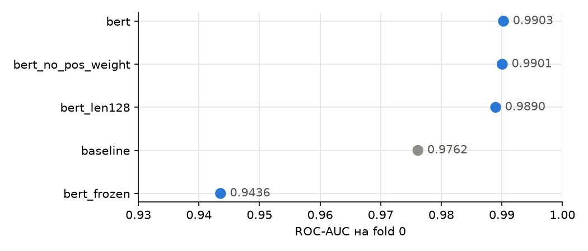
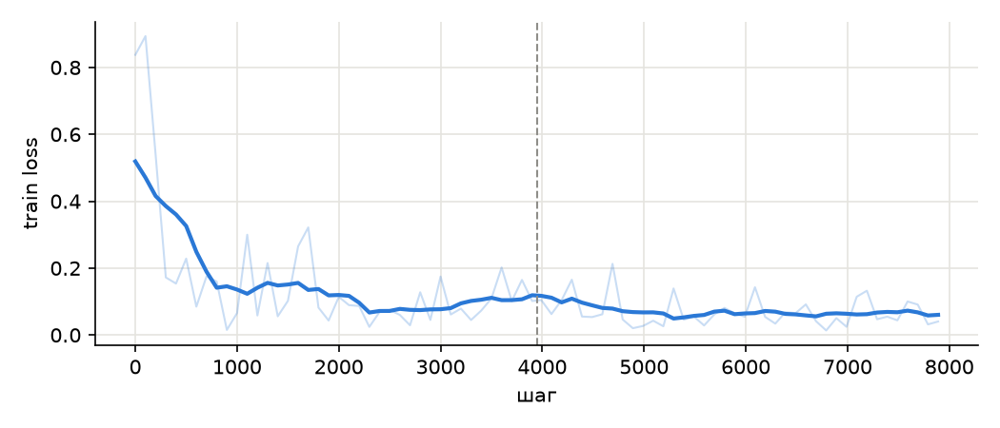

# Toxic Comment Classification — ДЗ1 и ДЗ2

Baseline для соревнования [Jigsaw Toxic Comment Classification Challenge](https://www.kaggle.com/competitions/jigsaw-toxic-comment-classification-challenge).

## Запуск

Нужны uv, GPU для BERT, токен Kaggle в `~/.kaggle/kaggle.json` и принятые правила соревнования на сайте.

```bash
./scripts/run_baseline.sh                      # TF-IDF + LogReg
./scripts/run_baseline.sh configs/random.yaml  # случайная модель
./scripts/run_bert.sh                          # BERT и три абляции
uv run python -m src.misc.plot_experiments     # графики и таблица
uv run mlflow ui                               # история экспериментов
```

Результаты запуска сохраняются в `runs/` и в MLflow.

## Задача

По тексту комментария из обсуждений Википедии предсказываем вероятности шести видов токсичности — `toxic`, `severe_toxic`, `obscene`, `threat`, `insult`, `identity_hate`. Классы пересекаются, поэтому это multilabel, применение — автоматическая модерация, где порог подбирается под площадку.

- Объект — один комментарий
- `X` — текст, другой информации на inference нет
- `y` — шесть бинарных меток

**Гипотеза.** TF-IDF и логистическая регрессия дадут средний ROC-AUC не ниже 0.90 против 0.5 у случайной модели, потому что токсичность в основном выражается лексически.

## Данные

159 571 комментарий в train и 63 978 размеченных в test, строки теста с меткой `-1` в оценке не участвовали, пропусков нет.

| метка | доля в train | доля в test |
|---|---|---|
| toxic | 9.6% | 9.5% |
| severe_toxic | 1.0% | 0.6% |
| obscene | 5.3% | 5.8% |
| threat | 0.3% | 0.3% |
| insult | 4.9% | 5.4% |
| identity_hate | 0.9% | 1.1% |

- Около 90% комментариев чистые
- Дубликатов внутри train и между train и test нет

## Baseline и протокол

`TfidfVectorizer()` + `OneVsRestClassifier(LogisticRegression())` с параметрами sklearn по умолчанию, конфиг в `configs/baseline.yaml`.

- Метрика — средний ROC-AUC по шести меткам, как в соревновании
- Валидация — 5 фолдов `MultilabelStratifiedKFold`, итог как среднее +- std
- TF-IDF обучается только на train-части фолда, чтобы не было утечки
- Тест используется один раз в конце, модель по нему не выбирается

## Результаты

| | CV | test |
|---|---|---|
| случайная модель | 0.4988 ± 0.0012 | 0.4984 |
| **TF-IDF + LogReg** | **0.9777 ± 0.0019** | **0.9723** |
| toxic | 0.9708 ± 0.0021 | 0.9581 |
| severe_toxic | 0.9841 ± 0.0018 | 0.9810 |
| obscene | 0.9834 ± 0.0012 | 0.9723 |
| threat | 0.9804 ± 0.0069 | 0.9837 |
| insult | 0.9760 ± 0.0024 | 0.9643 |
| identity_hate | 0.9716 ± 0.0048 | 0.9741 |

Гипотеза подтвердилась, хуже всего модель работает на `toxic`, у `threat` самый большой разброс между фолдами из-за малого числа позитивов.

**Типичные ошибки**

1. Шум разметки — «You are retarded… MORON!» помечен как чистый, модель даёт 0.99
2. Токсичность без грубых слов, особенность подхода с tf-idf — «Thanks for participating in the conspiracy against me.» помечен как `toxic`, модель даёт 0.004

## Выводы

Baseline работает и даёт 0.972 на тесте, он не понимает контекст и сарказм и реагирует на отдельные слова.

**Следующая гипотеза.** Дообученный BERT-base поднимет ROC-AUC на тесте минимум на 0.005, потому что учитывает контекст.

## Исследовательские вопросы

1. Падает ли ROC-AUC, если обрезать комментарии до 128, 256 и 512 токенов?
2. Растёт ли PR-AUC `threat` и `identity_hate` с `class_weight="balanced"` без падения среднего ROC-AUC больше чем на std?
3. Лучше ли char-TF-IDF, чем word-TF-IDF, на комментариях с маскировкой вроде `f*ck`?

## ДЗ2 — BERT

### Улучшения по сравнению с baseline

**Гипотеза.** TF-IDF не видит токсичность без грубых слов вроде сарказма, дообученный BERT учитывает контекст и поднимет ROC-AUC на тесте минимум на 0.005.

Модель — `bert-base-uncased`, обучалась с `max_len` 512, 2 эпохи, lr 2e-5, `pos_weight = sqrt(neg/pos)`, конфиги в `configs/bert*.yaml`, код в `src/train/train_bert.py`.

### Трекинг экспериментов

Все запуски в MLflow, на fold 0 с seed 42.

| эксперимент | что изменено | гипотеза | ROC-AUC fold 0 |
|---|---|---|---|
| baseline | TF-IDF + LogReg | точка отсчёта | 0.9762 |
| **bert** | BERT вместо TF-IDF | контекст поднимет качество | **0.9903** |
| bert_frozen | энкодер заморожен, lr 1e-3 | прирост даёт дообучение | 0.9436 |
| bert_len128 | `max_len` 128 | длинный контекст важен | 0.9890 |
| bert_no_pos_weight | без `pos_weight` | веса помогают редким меткам | 0.9901 |

На тесте BERT даёт 0.9866 против 0.9723 у baseline.

### Абляции

- Без дообучения энкодера BERT хуже даже TF-IDF, весь прирост даёт дообучение
- `max_len` 128 вместо 512 даёт разницу 0.0013, что меньше разброса между фолдами у baseline в 0.0019, а учится в 3 раза быстрее
- Без `pos_weight` среднее почти то же, но `threat` падает с 0.9899 до 0.9877 и после первой эпохи модель хуже — 0.9887 против 0.9903

### Честное сравнение

- Фолды задаются одной функцией `get_folds` в `src/train/utils.py` для всех запусков
- Метрика одна и та же, модели учатся только на train-части фолда
- Тест посчитан один раз для итоговой модели, по нему ничего не подбиралось
- Модели, уже дообученные на этих данных вроде `unitary/toxic-bert`, не использовались
- На тесте у baseline среднее пяти моделей, у BERT одна

### Выводы

- Гипотеза подтвердилась, прирост на тесте 0.014
- Главный вклад даёт дообучение, длина контекста и `pos_weight` на среднем почти не влияют
- У bert вторая эпоха прироста не дала, ROC-AUC после первой уже 0.9903

### Обязательные артефакты

- `reports/experiments.csv` — параметры и метрики всех запусков
- `reports/experiments.png` — ROC-AUC по экспериментам
- `reports/bert_train_loss.png` — кривая обучения, пунктир — граница эпох
- `reports/bert_oof_fold0.csv` — предсказания BERT на fold 0
- `runs/` — логи, конфиги и предсказания каждого запуска, создаются при запуске




